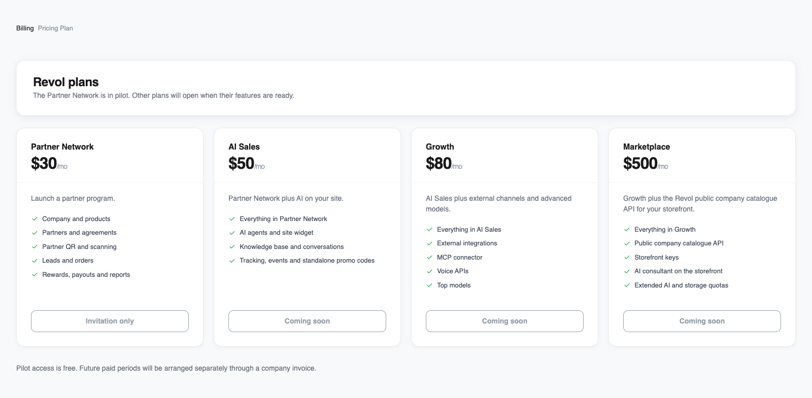
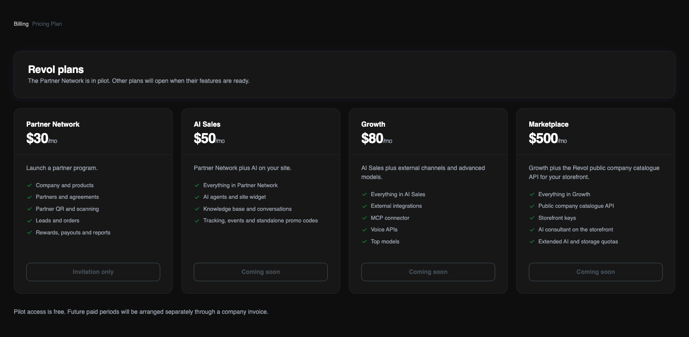

## Catalogue and availability

From a partner programme to AI sales and your own marketplace. Monthly prices cover the owner account; the team and all its companies share the plan’s quotas.

<Note>
Partner Network is currently available through a free, invitation-only pilot. After the pilot, it costs $30/month; pilot participants keep that price for their first six confirmed paid months.

These are catalogue prices. AI Sales, Growth and Marketplace are not open for self-service activation. The Revol team arranges access and payment.
</Note>

<Frame>
  
  
</Frame>

The same plans and availability shown in the Revol admin panel. Screenshots use the English interface.

## What each plan includes

<Tabs>
  <Tab title="Partner Network">
    Launch a partner program.

    - Company and products
    - Partners and agreements
    - Partner QR and scanning
    - Leads and orders
    - Rewards, payouts and reports
  </Tab>
  <Tab title="AI Sales">
    Partner Network plus AI on your site.

    - Everything in Partner Network
    - AI agents and site widget
    - Knowledge base and conversations
    - Tracking, events and standalone promo codes
  </Tab>
  <Tab title="Growth">
    AI Sales plus external channels and advanced models.

    - Everything in AI Sales
    - External integrations
    - MCP connector
    - Voice APIs
    - Top models
  </Tab>
  <Tab title="Marketplace">
    Growth plus the Revol public company catalogue API for your storefront.

    - Everything in Growth
    - Public company catalogue API
    - Storefront keys
    - AI consultant on the storefront
    - Extended AI and storage quotas
  </Tab>
</Tabs>

## Included quotas

| Resource | Partner Network | AI Sales | Growth | Marketplace |
|---|---|---|---|---|
| Monthly price, USD | $30 | $50 | $80 | $500 |
| Availability | Invitation-only pilot | Coming soon | Coming soon | Coming soon |
| Companies | 1 | 1 | 3 | 5 |
| AI agents | — | 1 | 3 | 10 |
| Team seats, including owner | 3 | 5 | 15 | 30 |
| Text tokens | — | 10 000 000 | 20 000 000 | 100 000 000 |
| Premium tokens | — | — | 500 000 | 3 000 000 |
| Indexing tokens (embeddings) | — | 1 000 000 | 3 000 000 | 20 000 000 |
| Speech recognition (STT), minutes | — | — | 500 | 2 000 |
| Speech synthesis (TTS), characters | — | — | 200 000 | 200 000 |
| File storage | 1 GiB | 5 GiB | 20 GiB | 100 GiB |
| Vector storage | — | 50 MiB | 200 MiB | 1 GiB |
| Knowledge sources | — | 200 | 1 000 | 5 000 |
| Tracking sessions | — | 20 000 | 50 000 | 200 000 |

All quotas are shared across the owner’s account. Text, premium, indexing, voice and tracking quotas apply to the usage period shown in Billing. Companies, agents, seats, sources and stored bytes are capacity limits, not a monthly allowance that clears your data. A dash means the resource is not included. GiB and MiB use powers of 1024; the dashboard labels these units GB and MB.

## AI and voice models

**AI Sales** includes GPT-4o mini and text-embedding-3-small. **Growth** and **Marketplace** also include GPT-4o, Whisper (whisper-1), and OpenAI TTS (tts-1 / tts-1-hd), within their separate quotas. Partner Network does not include AI resources.

Marketplace also allows ElevenLabs models (eleven_v4_turbo and eleven_multilingual_v2) for a configured integration. A company’s own ElevenLabs connection is billed through its provider account, separately from the Revol OpenAI TTS quota. Telephone and other external service fees follow the provider’s terms.

## Access and payment

1. Contact the Revol team to agree the plan and access dates. Partner Network is available by invitation; trials of other plans are assigned separately.

2. The partner pilot is free until the agreed date. Its participants retain the $30 monthly price for their first six confirmed paid monthly periods. Pilot extensions and gaps between payments do not consume those periods.

3. For paid access, the team issues a bank-transfer invoice in USD or UAH. If invoiced in UAH, the exchange rate is specified in the invoice. Access is confirmed after receipt of payment; a pilot or trial does not create a debt or an automatic charge.

When access expires, new operations that require an active plan stop. Existing data remains available for review; a trial does not silently become another paid plan. To extend or change access, contact the team.

[How to read usage and remaining quotas](/en/billing/usage)
