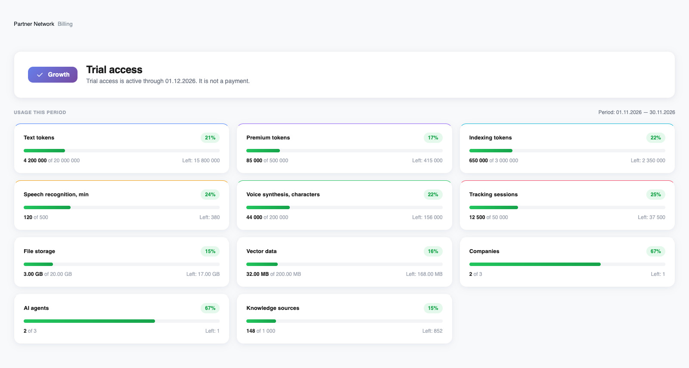
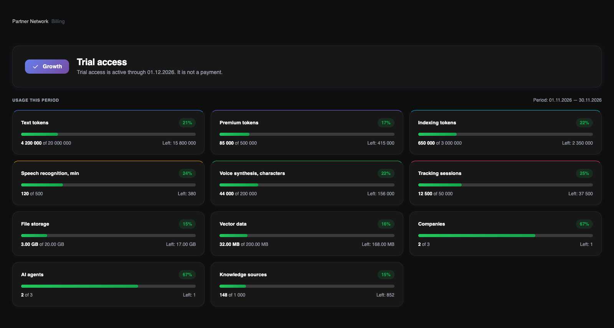

Open **Billing** to see the account owner’s plan, access status and current resource usage. **Pricing Plan** opens the catalogue; it does not activate a subscription.

<Frame>
  
  
</Frame>

English interface, in light and dark themes. The usage example uses illustrative values, not customer data.

## Plan and access status

The top card shows the assigned plan and whether pilot, trial or confirmed paid access is active. It displays the access end date; for paid access, it also shows the paid-period number. That date is an access boundary, not a scheduled card charge.

The plan covers the owner’s companies, while each teammate’s role still determines which data and operations they can access. Seats are counted by unique email across the account, including the owner and invitations.

## Reading the resource cards

Only resources included in the assigned plan appear. Each card shows used quantity, the plan limit, remaining quantity and a percentage. AI usage includes resources already reserved for work in progress.

Text and premium tokens cover model input and output. Indexing tokens create embeddings for knowledge search; they do not train the underlying language model. Voice uses minutes for speech recognition and characters for synthesis. File and vector storage are separate limits.

## Periods and limits

For paid access, the usage period follows the confirmed paid period. Pilot and trial periods are monthly windows anchored to the assigned access date. Use the dates displayed in Billing; a period need not start on the first of the calendar month.

Resource indicators are green below 80%, amber from 80%, and red from 90%. These are visual thresholds, not an extra charge. Reaching a quota blocks new operations that need that resource. Capacity limits do not reset with the next month.

<Note>
The “Usage Events” area is currently a preview placeholder. A searchable event log, filters and export are not available on this page.
</Note>

For more capacity or a different plan, contact the Revol team. There is no automatic overage charge or instant self-service upgrade.

[Compare plans and included quotas](/en/billing/plans)
