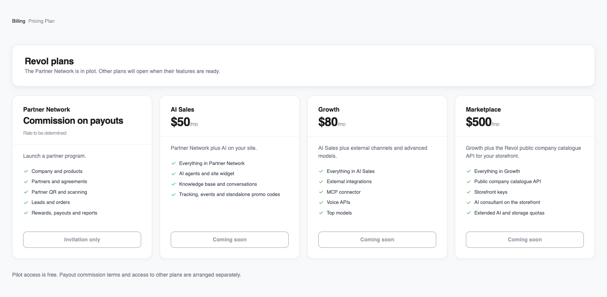
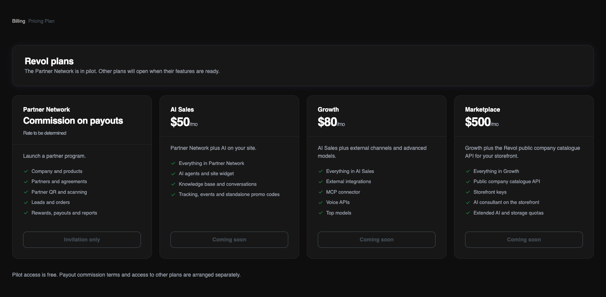

## Katalog und Verfügbarkeit

Vom Partnerprogramm über KI-Vertrieb bis zum eigenen Marktplatz. Das Partnernetzwerk nutzt eine Provision auf Auszahlungen; die anderen Tarife haben einen Monatspreis pro Inhaberkonto. Unternehmen teilen sich die Kontingente.

<Note>
Das Partnernetzwerk nutzt ein Provisionsmodell auf Auszahlungen. Satz und Bedingungen werden separat festgelegt. Der Pilot bleibt kostenlos.

Angezeigt werden Katalogpreise. KI-Vertrieb, Wachstum und Marktplatz lassen sich noch nicht selbst aktivieren. Das Revol-Team vereinbart Zugang und Zahlung mit Ihnen.
</Note>

<Frame>
  
  
</Frame>

Dieselben Tarife und Verfügbarkeiten wie im Revol-Verwaltungsbereich. Die Screenshots zeigen die englische Oberfläche.

## Leistungen der Tarife

<Tabs>
  <Tab title="Partnernetzwerk">
    Starten Sie ein Partnerprogramm.

    - Unternehmen und Produkte
    - Partner und Vereinbarungen
    - Partner-QR und Scannen
    - Leads und Bestellungen
    - Prämien, Auszahlungen und Berichte
  </Tab>
  <Tab title="KI-Vertrieb">
    Partnernetzwerk plus KI auf Ihrer Website.

    - Alles aus Partnernetzwerk
    - KI-Agenten und Website-Widget
    - Wissensdatenbank und Gespräche
    - Tracking, Ereignisse und eigenständige Promo-Codes
  </Tab>
  <Tab title="Wachstum">
    KI-Vertrieb plus externe Kanäle und fortgeschrittene Modelle.

    - Alles aus KI-Vertrieb
    - Externe Integrationen
    - MCP-Connector
    - Sprach-APIs
    - Top-Modelle
  </Tab>
  <Tab title="Marktplatz">
    Wachstum plus die öffentliche Revol-Unternehmenskatalog-API für Ihre Storefront.

    - Alles aus Wachstum
    - Öffentliche Unternehmenskatalog-API
    - Storefront-Schlüssel
    - KI-Berater in der Storefront
    - Erweiterte KI- und Speicherkontingente
  </Tab>
</Tabs>

## Enthaltene Kontingente

| Ressource | Partnernetzwerk | KI-Vertrieb | Wachstum | Marktplatz |
|---|---|---|---|---|
| Preismodell / Preis | Provision auf Auszahlungen | $50 / Monat | $80 / Monat | $500 / Monat |
| Verfügbarkeit | Pilot auf Einladung | Demnächst | Demnächst | Demnächst |
| Unternehmen | 1 | 1 | 3 | 5 |
| KI-Agenten | — | 1 | 3 | 10 |
| Teamplätze einschließlich Inhaber | 3 | 5 | 15 | 30 |
| Text-Token | — | 10 000 000 | 20 000 000 | 100 000 000 |
| Premium-Token | — | — | 500 000 | 3 000 000 |
| Indexierungs-Token (Embeddings) | — | 1 000 000 | 3 000 000 | 20 000 000 |
| Spracherkennung (STT), Minuten | — | — | 500 | 2 000 |
| Sprachsynthese (TTS), Zeichen | — | — | 200 000 | 200 000 |
| Dateispeicher | 1 GiB | 5 GiB | 20 GiB | 100 GiB |
| Vektorspeicher | — | 50 MiB | 200 MiB | 1 GiB |
| Wissensquellen | — | 200 | 1 000 | 5 000 |
| Tracking-Sitzungen | — | 20 000 | 50 000 | 200 000 |

Alle Kontingente gelten gemeinsam für das Konto des Inhabers. Text-, Premium-, Indexierungs-, Sprach- und Tracking-Kontingente beziehen sich auf den in Billing angezeigten Zeitraum. Unternehmen, Agenten, Plätze, Quellen und Speicher sind Kapazitätsgrenzen, die Ihre Daten nicht monatlich löschen. Ein Strich bedeutet, dass die Ressource nicht enthalten ist. GiB und MiB basieren auf 1024; das Dashboard bezeichnet sie als GB und MB.

## KI- und Sprachmodelle

**KI-Vertrieb** enthält GPT-4o mini und text-embedding-3-small. **Wachstum** und **Marktplatz** enthalten zusätzlich GPT-4o, Whisper (whisper-1) und OpenAI TTS (tts-1 / tts-1-hd) mit eigenen Kontingenten. Partnernetzwerk enthält keine KI-Ressourcen.

Marktplatz erlaubt außerdem ElevenLabs-Modelle (eleven_v4_turbo und eleven_multilingual_v2) für eine eingerichtete Integration. Eine eigene ElevenLabs-Verbindung des Unternehmens wird über dessen Anbieterkonto abgerechnet, unabhängig vom Revol-Kontingent für OpenAI TTS. Telefonie und andere externe Dienste unterliegen den Gebühren des Anbieters.

## Zugang und Zahlung

1. Vereinbaren Sie Tarif und Zugangszeitraum mit dem Revol-Team. Das Partnernetzwerk ist auf Einladung verfügbar; Testzugänge zu anderen Tarifen werden gesondert vergeben.

2. Das Partnernetzwerk sieht eine Provision auf Auszahlungen statt einer Monatsgebühr vor. Satz und Bedingungen stehen noch nicht fest; automatische Abzüge sind nicht aktiviert. Der Pilot bleibt bis zum vereinbarten Datum kostenlos.

3. Monatliche Tarife können noch nicht gekauft werden. Nach der Freigabe wird die Zahlung per Banküberweisung auf Rechnung in USD oder UAH vereinbart. Eine UAH-Rechnung enthält den Wechselkurs. Der Zugang wird nach Zahlungseingang bestätigt; Pilot und Test lösen keine automatische Abbuchung aus.

Nach Ablauf des Zugangs werden neue Vorgänge ausgesetzt, die einen aktiven Tarif erfordern. Vorhandene Daten bleiben einsehbar; ein Test wird nicht automatisch in einen anderen kostenpflichtigen Tarif umgewandelt. Verlängerungen oder Änderungen vereinbaren Sie mit dem Team.

[Verbrauch und verbleibende Kontingente verstehen](/de/billing/usage)
