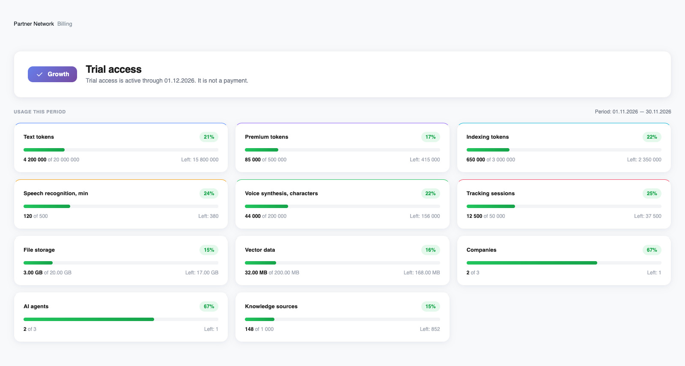
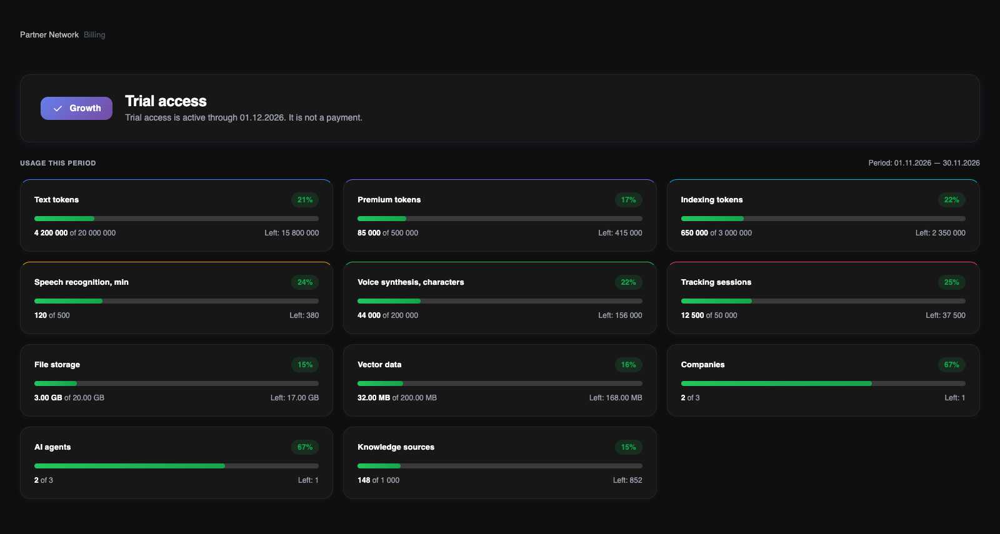

Öffnen Sie **Billing**, um den Tarif des Kontoinhabers, den Zugangsstatus und den Ressourcenverbrauch zu sehen. **Pricing Plan** öffnet den Katalog, aktiviert aber kein Abonnement.

<Frame>
  
  
</Frame>

Englische Oberfläche im hellen und dunklen Design. Die Verbrauchswerte sind Beispieldaten, keine Kundendaten.

## Tarif und Zugangsstatus

Die obere Karte zeigt den zugewiesenen Tarif und den Status des Pilot-, Test- oder bestätigten bezahlten Zugangs. Sie zeigt das Zugangsende und bei bezahltem Zugang auch die Nummer des bezahlten Zeitraums. Dieses Datum ist keine geplante Kartenabbuchung.

Der Tarif umfasst die Unternehmen des Inhabers; die Rolle jedes Teammitglieds bestimmt weiterhin die zugänglichen Daten und Aktionen. Plätze werden anhand eindeutiger E-Mail-Adressen im gesamten Konto gezählt, einschließlich Inhaber und Einladungen.

## Ressourcenkarten lesen

Es erscheinen nur Ressourcen, die im zugewiesenen Tarif enthalten sind. Jede Karte zeigt Verbrauch, Grenze, Restmenge und Prozentsatz. Der KI-Verbrauch enthält auch Ressourcen, die für laufende Arbeiten bereits reserviert sind.

Text- und Premium-Token umfassen Modelleingaben und -ausgaben. Indexierungs-Token erzeugen Embeddings für die Wissenssuche; sie trainieren nicht das Sprachmodell selbst. Sprache wird in Erkennungsminuten und Synthesezeichen gemessen. Datei- und Vektorspeicher haben getrennte Grenzen.

## Zeiträume und Grenzen

Bei bezahltem Zugang entspricht der Nutzungszeitraum dem bestätigten bezahlten Zeitraum. Pilot und Test verwenden monatliche Zeitfenster ab dem zugewiesenen Zugangsdatum. Maßgeblich sind die Daten in Billing; ein Zeitraum muss nicht am Monatsersten beginnen.

Die Anzeigen sind unter 80% grün, ab 80% orange und ab 90% rot. Das sind visuelle Schwellen, keine Zusatzgebühren. Ein ausgeschöpftes Kontingent blockiert neue Vorgänge, die diese Ressource benötigen. Kapazitätsgrenzen werden nicht monatlich zurückgesetzt.

<Note>
Der Bereich „Usage Events“ ist derzeit ein Vorschauplatzhalter. Ein durchsuchbares Ereignisprotokoll, Filter und Export stehen auf dieser Seite noch nicht zur Verfügung.
</Note>

Für mehr Kapazität oder einen anderen Tarif wenden Sie sich an das Revol-Team. Es gibt weder automatische Mehrverbrauchsgebühren noch sofortige eigenständige Tarif-Upgrades.

[Tarife und Kontingente vergleichen](/de/billing/plans)
