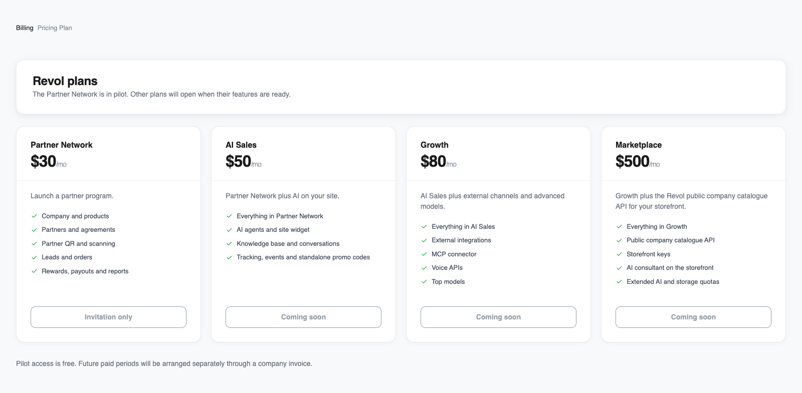
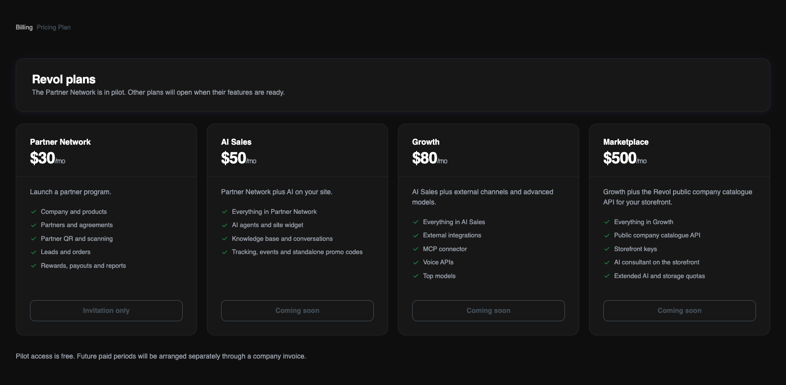

## Catálogo y disponibilidad

Desde un programa de socios hasta ventas con IA y tu propio marketplace. El precio mensual cubre la cuenta del propietario; el equipo y todas sus empresas comparten las cuotas del plan.

<Note>
Red de socios está disponible mediante un piloto gratuito por invitación. Después cuesta $30/mes. Sus participantes mantienen ese precio durante los primeros seis meses pagados y confirmados.

Se muestran los precios del catálogo. Ventas con IA, Crecimiento y Marketplace aún no admiten activación por cuenta propia. El equipo de Revol acuerda el acceso y el pago contigo.
</Note>

<Frame>
  
  
</Frame>

Los mismos planes y estados de disponibilidad que muestra el panel de Revol. Las capturas utilizan la interfaz en inglés.

## Qué incluye cada plan

<Tabs>
  <Tab title="Red de socios">
    Lanza un programa de socios.

    - Empresa y productos
    - Socios y acuerdos
    - QR de socio y escaneo
    - Leads y pedidos
    - Recompensas, pagos y informes
  </Tab>
  <Tab title="Ventas con IA">
    Red de socios más IA en tu sitio web.

    - Todo lo de Red de socios
    - Agentes de IA y widget del sitio
    - Base de conocimiento y conversaciones
    - Seguimiento, eventos y códigos promocionales independientes
  </Tab>
  <Tab title="Crecimiento">
    Ventas con IA más canales externos y modelos avanzados.

    - Todo lo de Ventas con IA
    - Integraciones externas
    - Conector MCP
    - APIs de voz
    - Modelos top
  </Tab>
  <Tab title="Marketplace">
    Crecimiento más la API pública del catálogo de empresas de Revol para tu escaparate.

    - Todo lo de Crecimiento
    - API pública del catálogo de empresas
    - Claves de escaparate
    - Asesor de IA en el escaparate
    - Cuotas ampliadas de IA y almacenamiento
  </Tab>
</Tabs>

## Cuotas incluidas

| Recurso | Red de socios | Ventas con IA | Crecimiento | Marketplace |
|---|---|---|---|---|
| Precio mensual, USD | $30 | $50 | $80 | $500 |
| Disponibilidad | Piloto por invitación | Próximamente | Próximamente | Próximamente |
| Empresas | 1 | 1 | 3 | 5 |
| Agentes de IA | — | 1 | 3 | 10 |
| Plazas del equipo, incluido el propietario | 3 | 5 | 15 | 30 |
| Tokens de texto | — | 10 000 000 | 20 000 000 | 100 000 000 |
| Tokens premium | — | — | 500 000 | 3 000 000 |
| Tokens de indexación (embeddings) | — | 1 000 000 | 3 000 000 | 20 000 000 |
| Reconocimiento de voz (STT), minutos | — | — | 500 | 2 000 |
| Síntesis de voz (TTS), caracteres | — | — | 200 000 | 200 000 |
| Almacenamiento de archivos | 1 GiB | 5 GiB | 20 GiB | 100 GiB |
| Almacenamiento vectorial | — | 50 MiB | 200 MiB | 1 GiB |
| Fuentes de conocimiento | — | 200 | 1 000 | 5 000 |
| Sesiones de seguimiento | — | 20 000 | 50 000 | 200 000 |

Todas las cuotas se comparten en la cuenta del propietario. Texto, premium, indexación, voz y seguimiento corresponden al periodo mostrado en Billing. Empresas, agentes, plazas, fuentes y almacenamiento son límites de capacidad, no una asignación mensual que borre los datos. Un guion significa que el recurso no está incluido. GiB y MiB usan múltiplos de 1024; el panel los identifica como GB y MB.

## Modelos de IA y voz

**Ventas con IA** incluye GPT-4o mini y text-embedding-3-small. **Crecimiento** y **Marketplace** también incluyen GPT-4o, Whisper (whisper-1) y OpenAI TTS (tts-1 / tts-1-hd), con cuotas separadas. Red de socios no incluye recursos de IA.

Marketplace también permite modelos de ElevenLabs (eleven_v4_turbo y eleven_multilingual_v2) para una integración configurada. La conexión propia de ElevenLabs de una empresa se factura en su cuenta del proveedor, aparte de la cuota de Revol para OpenAI TTS. La telefonía y otros servicios externos se cobran según las condiciones de sus proveedores.

## Acceso y pago

1. Contacta con el equipo de Revol para acordar el plan y las fechas de acceso. Red de socios está disponible por invitación; las pruebas de otros planes se asignan por separado.

2. El piloto de socios es gratuito hasta la fecha acordada. Sus participantes conservan el precio de $30 durante los primeros seis periodos mensuales pagados y confirmados. Las ampliaciones del piloto y los intervalos sin pago no consumen esos periodos.

3. Para el acceso de pago, el equipo emite una factura por transferencia bancaria en USD o UAH. En UAH, el tipo de cambio se indica en la factura. El acceso se confirma al recibir los fondos; un piloto o una prueba no generan deuda ni cargos automáticos.

Al caducar el acceso se detienen las nuevas operaciones que requieren un plan activo. Los datos existentes siguen disponibles para consulta; una prueba no se convierte automáticamente en otro plan de pago. Acuerda cualquier ampliación o cambio con el equipo.

[Cómo interpretar el uso y las cuotas restantes](/es/billing/usage)
