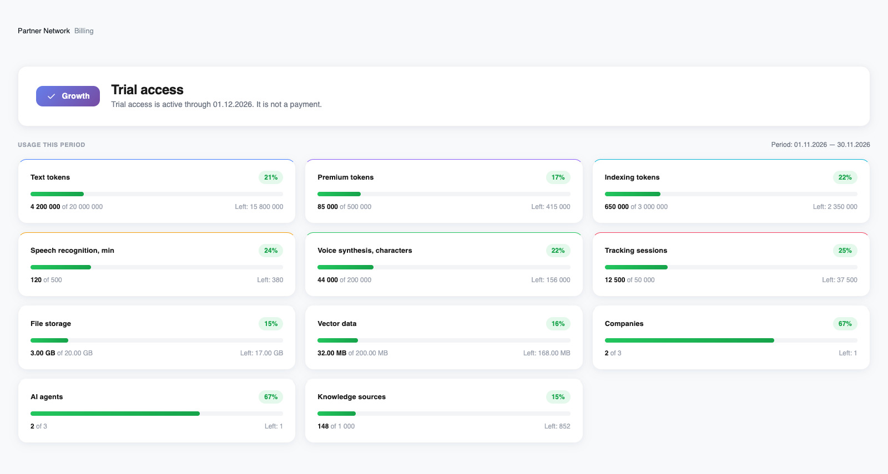
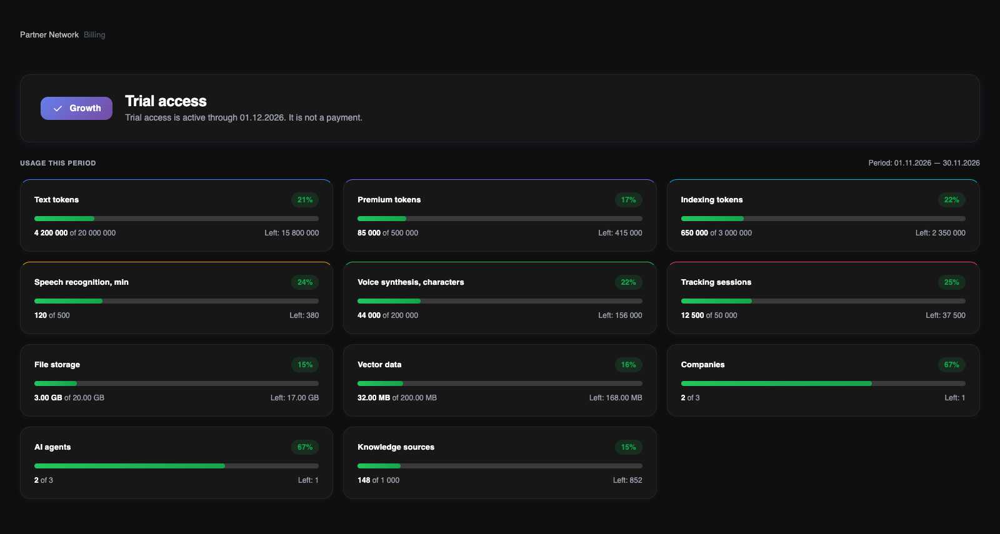

Abre **Billing** para ver el plan del propietario de la cuenta, el estado del acceso y el uso actual. **Pricing Plan** abre el catálogo, pero no activa una suscripción.

<Frame>
  
  
</Frame>

Interfaz en inglés, con temas claro y oscuro. El ejemplo de uso contiene valores ilustrativos, no datos de clientes.

## Plan y estado del acceso

La tarjeta superior muestra el plan asignado y si el acceso de piloto, prueba o pago confirmado está activo. Incluye la fecha de fin de acceso y, para el acceso de pago, el número del periodo pagado. Esa fecha no es un cargo programado en la tarjeta.

El plan cubre las empresas del propietario, pero el rol de cada miembro sigue determinando los datos y acciones permitidos. Las plazas se cuentan por correo electrónico único en toda la cuenta, incluido el propietario y las invitaciones.

## Cómo leer las tarjetas de recursos

Solo aparecen los recursos incluidos en el plan asignado. Cada tarjeta muestra la cantidad usada, el límite, lo que queda y un porcentaje. El uso de IA incluye recursos ya reservados para tareas en curso.

Los tokens de texto y premium cubren la entrada y salida del modelo. Los tokens de indexación generan embeddings para buscar en la base de conocimiento; no entrenan el modelo de lenguaje. La voz se mide en minutos de reconocimiento y caracteres de síntesis. Los archivos y vectores tienen límites separados.

## Periodos y límites

Para el acceso de pago, el periodo de uso coincide con el periodo pagado confirmado. Los pilotos y pruebas tienen ventanas mensuales desde la fecha de acceso asignada. Consulta las fechas en Billing: el periodo no tiene por qué empezar el primer día del mes.

Los indicadores son verdes por debajo del 80%, naranjas desde el 80% y rojos desde el 90%. Son umbrales visuales, no cargos adicionales. Agotar una cuota bloquea nuevas operaciones que necesiten ese recurso. Los límites de capacidad no se reinician cada mes.

<Note>
El área «Usage Events» es por ahora una vista de ejemplo. Esta página aún no dispone de registro de eventos con búsqueda, filtros ni exportación.
</Note>

Para ampliar la capacidad o cambiar de plan, contacta con el equipo de Revol. No hay cargos automáticos por exceso ni mejoras instantáneas del plan por cuenta propia.

[Comparar planes y cuotas](/es/billing/plans)
