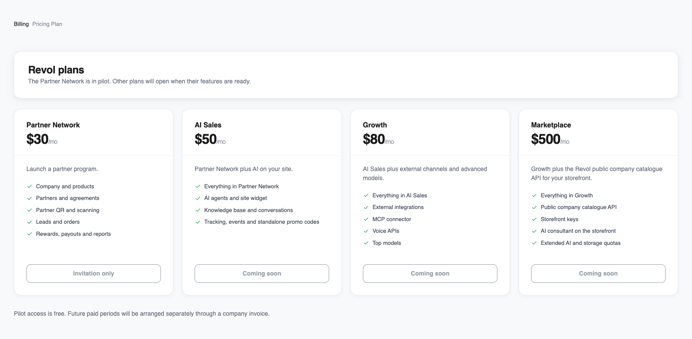
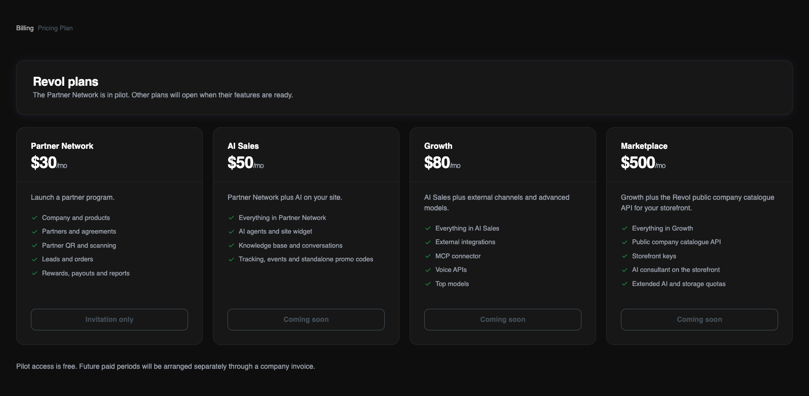

## Katalog i dostępność

Od programu partnerskiego po sprzedaż z AI i własny marketplace. Cena miesięczna dotyczy konta właściciela, a zespół i wszystkie jego firmy korzystają ze wspólnych limitów.

<Note>
Sieć partnerska jest obecnie dostępna w bezpłatnym pilotażu na zaproszenie. Po pilotażu cena wynosi $30/mies.; uczestnicy zachowują ją przez pierwszych sześć potwierdzonych płatnych miesięcy.

Podane kwoty to ceny katalogowe. Sprzedaż AI, Rozwój i Marketplace nie są jeszcze dostępne do samodzielnej aktywacji. Dostęp i płatności uzgadnia zespół Revol.
</Note>

<Frame>
  
  
</Frame>

Te same plany i statusy dostępności, które widać w panelu Revol. Zrzuty przedstawiają interfejs w języku angielskim.

## Co obejmują plany

<Tabs>
  <Tab title="Sieć partnerska">
    Uruchom program partnerski.

    - Firma i produkty
    - Partnerzy i umowy
    - QR partnera i skanowanie
    - Leady i zamówienia
    - Nagrody, wypłaty i raporty
  </Tab>
  <Tab title="Sprzedaż AI">
    Sieć partnerska plus AI na Twojej stronie.

    - Wszystko z planu Sieć partnerska
    - Agenci AI i widżet na stronę
    - Baza wiedzy i rozmowy
    - Śledzenie, zdarzenia i samodzielne kody promocyjne
  </Tab>
  <Tab title="Rozwój">
    Sprzedaż AI plus kanały zewnętrzne i zaawansowane modele.

    - Wszystko z planu Sprzedaż AI
    - Integracje zewnętrzne
    - Konektor MCP
    - API głosowe
    - Najlepsze modele
  </Tab>
  <Tab title="Marketplace">
    Rozwój plus publiczne API katalogu firm Revol dla Twojej witryny.

    - Wszystko z planu Rozwój
    - Publiczne API katalogu firm
    - Klucze witryny
    - Konsultant AI na witrynie
    - Rozszerzone limity AI i pamięci
  </Tab>
</Tabs>

## Limity w planach

| Zasób | Sieć partnerska | Sprzedaż AI | Rozwój | Marketplace |
|---|---|---|---|---|
| Cena miesięczna, USD | $30 | $50 | $80 | $500 |
| Dostępność | Pilotaż na zaproszenie | Wkrótce | Wkrótce | Wkrótce |
| Firmy | 1 | 1 | 3 | 5 |
| Agenci AI | — | 1 | 3 | 10 |
| Miejsca zespołu z właścicielem | 3 | 5 | 15 | 30 |
| Tokeny tekstowe | — | 10 000 000 | 20 000 000 | 100 000 000 |
| Tokeny premium | — | — | 500 000 | 3 000 000 |
| Tokeny indeksowania (embeddings) | — | 1 000 000 | 3 000 000 | 20 000 000 |
| Rozpoznawanie mowy (STT), minuty | — | — | 500 | 2 000 |
| Synteza mowy (TTS), znaki | — | — | 200 000 | 200 000 |
| Przestrzeń na pliki | 1 GiB | 5 GiB | 20 GiB | 100 GiB |
| Przestrzeń wektorowa | — | 50 MiB | 200 MiB | 1 GiB |
| Źródła wiedzy | — | 200 | 1 000 | 5 000 |
| Sesje śledzenia | — | 20 000 | 50 000 | 200 000 |

Wszystkie limity są wspólne dla konta właściciela. Tokeny tekstowe, premium, indeksowanie, głos i śledzenie dotyczą okresu widocznego w Billing. Firmy, agenci, miejsca, źródła i przestrzeń dyskowa to limity pojemności, które nie zerują danych co miesiąc. Kreska oznacza brak zasobu w planie. GiB i MiB używają mnożnika 1024; panel oznacza te jednostki jako GB i MB.

## Modele AI i głosu

**Sprzedaż AI** obejmuje GPT-4o mini i text-embedding-3-small. **Rozwój** i **Marketplace** obejmują również GPT-4o, Whisper (whisper-1) oraz OpenAI TTS (tts-1 / tts-1-hd), w ramach osobnych limitów. Sieć partnerska nie obejmuje zasobów AI.

Marketplace zezwala także na modele ElevenLabs (eleven_v4_turbo i eleven_multilingual_v2) dla skonfigurowanej integracji. Własne połączenie ElevenLabs firmy jest rozliczane na koncie dostawcy, oddzielnie od limitu Revol na OpenAI TTS. Telefonia i inne usługi zewnętrzne podlegają opłatom dostawców.

## Dostęp i płatności

1. Skontaktuj się z zespołem Revol, aby uzgodnić plan i daty dostępu. Sieć partnerska działa na zaproszenie; testowy dostęp do innych planów przyznawany jest oddzielnie.

2. Pilotaż partnerski jest bezpłatny do uzgodnionej daty. Uczestnicy zachowują cenę $30 przez pierwszych sześć potwierdzonych płatnych okresów miesięcznych. Przedłużenia pilotażu i przerwy między płatnościami nie zużywają tych okresów.

3. Dla płatnego dostępu zespół wystawia fakturę do przelewu w USD lub UAH. Przy UAH kurs jest podany na fakturze. Dostęp jest potwierdzany po otrzymaniu środków; pilotaż lub test nie powodują zadłużenia ani automatycznej płatności.

Po wygaśnięciu dostępu nowe operacje wymagające aktywnego planu zostają wstrzymane. Istniejące dane pozostają dostępne do przeglądania; test nie zmienia się automatycznie w inny płatny plan. Przedłużenie lub zmianę dostępu uzgodnij z zespołem.

[Jak odczytywać wykorzystanie i pozostałe limity](/pl/billing/usage)
