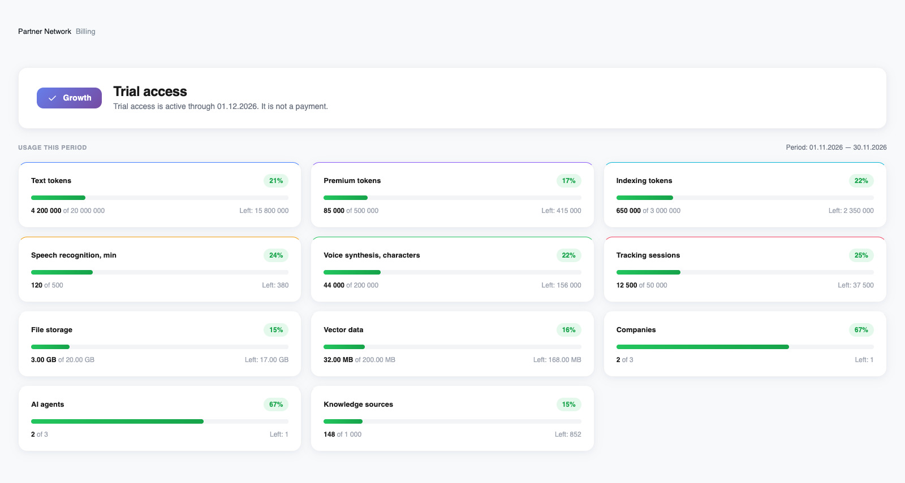
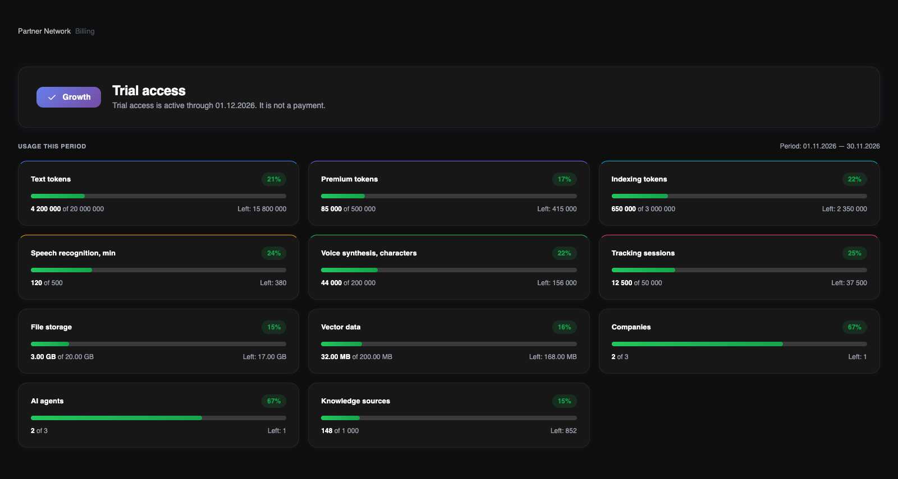

Otwórz **Billing**, aby zobaczyć plan właściciela konta, status dostępu i wykorzystane zasoby. **Pricing Plan** otwiera katalog, ale nie aktywuje subskrypcji.

<Frame>
  
  
</Frame>

Interfejs w języku angielskim, w jasnym i ciemnym motywie. Przykład wykorzystania zawiera dane demonstracyjne, a nie dane klientów.

## Plan i status dostępu

Górna karta pokazuje przydzielony plan i status dostępu pilotażowego, testowego lub potwierdzonego płatnego dostępu. Widoczna jest data końca dostępu; dla płatnego dostępu także numer opłaconego okresu. Data ta nie oznacza zaplanowanego obciążenia karty.

Plan obejmuje firmy właściciela, lecz role członków zespołu nadal określają dostępne dane i działania. Miejsca liczone są według unikalnych adresów e-mail w całym koncie, włącznie z właścicielem i zaproszeniami.

## Odczytywanie kart zasobów

Widoczne są wyłącznie zasoby objęte przydzielonym planem. Każda karta pokazuje wykorzystanie, limit, pozostałą ilość i procent. Wykorzystanie AI uwzględnia również zasoby zarezerwowane na trwające zadania.

Tokeny tekstowe i premium obejmują wejście i wyjście modelu. Tokeny indeksowania tworzą embeddings do wyszukiwania w bazie wiedzy, nie trenują samego modelu językowego. Głos mierzony jest minutami rozpoznawania i znakami syntezy. Pliki i wektory mają osobne limity.

## Okresy i ograniczenia

Dla płatnego dostępu okres wykorzystania odpowiada potwierdzonemu opłaconemu okresowi. Pilotaż i test mają miesięczne okresy liczone od daty przyznania dostępu. Sprawdzaj daty w Billing — okres nie musi zaczynać się pierwszego dnia miesiąca.

Wskaźniki są zielone poniżej 80%, pomarańczowe od 80% i czerwone od 90%. To progi wizualne, a nie dodatkowa opłata. Po wyczerpaniu limitu nowe operacje wymagające danego zasobu zostają zablokowane. Limity pojemności nie zerują się co miesiąc.

<Note>
Sekcja „Usage Events” jest obecnie podglądem zastępczym. Dziennik z wyszukiwaniem, filtrami i eksportem nie jest jeszcze dostępny na tej stronie.
</Note>

Aby zwiększyć zasoby lub zmienić plan, skontaktuj się z zespołem Revol. Nie ma automatycznych opłat za przekroczenie ani natychmiastowego samodzielnego przejścia na wyższy plan.

[Porównaj plany i limity](/pl/billing/plans)
