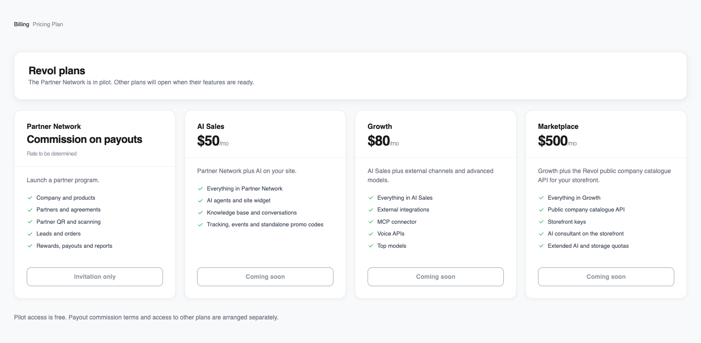
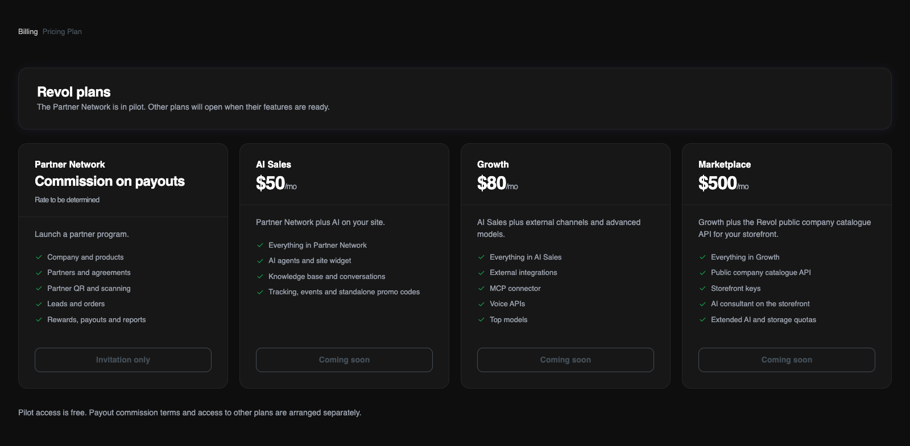

## Каталог і доступність

Від партнерської програми до AI-продажів і власного маркетплейсу. Партнерська мережа — за комісією з виплат; інші плани — за місячною ціною для акаунта власника. Компанії ділять квоти плану.

<Note>
Партнерська мережа — за моделлю комісії з виплат. Ставку та умови визначимо окремо. Пілот залишається безкоштовним.

Ціни наведені з каталогу. AI-продажі, Розширення та Маркетплейс ще не відкриті для самостійного підключення. Доступ і оплату узгоджує команда Revol.
</Note>

<Frame>
  
  
</Frame>

Ті самі плани й статуси доступності, які показує адмінка Revol. Інтерфейс на скріншоті — англійською.

## Що входить у плани

<Tabs>
  <Tab title="Партнерська мережа">
    Для запуску партнерської програми.

    - Компанія й товари
    - Партнери та угоди
    - Партнерські QR і сканування
    - Ліди й замовлення
    - Нарахування, виплати й звіти
  </Tab>
  <Tab title="AI-продажі">
    Партнерська мережа плюс AI на сайті.

    - Усе з Партнерської мережі
    - AI-агенти й віджет сайту
    - База знань і переписки
    - Трекінг, події й окремі промокоди
  </Tab>
  <Tab title="Розширення">
    AI-продажі плюс зовнішні канали й розширені моделі.

    - Усе з AI-продажів
    - Зовнішні інтеграції
    - MCP-конектор
    - Голосові API
    - Топові моделі
  </Tab>
  <Tab title="Маркетплейс">
    Розширення плюс API каталогу публічних компаній Revol для вашої вітрини.

    - Усе з Розширення
    - API каталогу публічних компаній
    - Ключі вітрини-маркетплейсу
    - AI-консультант на вітрині
    - Розширені квоти AI й сховища
  </Tab>
</Tabs>

## Включені квоти

| Ресурс | Партнерська мережа | AI-продажі | Розширення | Маркетплейс |
|---|---|---|---|---|
| Модель оплати / ціна | Комісія з виплат | $50 / місяць | $80 / місяць | $500 / місяць |
| Доступність | Пілот за запрошенням | Незабаром | Незабаром | Незабаром |
| Компанії | 1 | 1 | 3 | 5 |
| AI-агенти | — | 1 | 3 | 10 |
| Місця команди, включно з власником | 3 | 5 | 15 | 30 |
| Текстові токени | — | 10 000 000 | 20 000 000 | 100 000 000 |
| Преміум токени | — | — | 500 000 | 3 000 000 |
| Токени індексації (embeddings) | — | 1 000 000 | 3 000 000 | 20 000 000 |
| Розпізнавання мовлення (STT), хвилини | — | — | 500 | 2 000 |
| Синтез мовлення (TTS), символи | — | — | 200 000 | 200 000 |
| Файлове сховище | 1 GiB | 5 GiB | 20 GiB | 100 GiB |
| Векторне сховище | — | 50 MiB | 200 MiB | 1 GiB |
| Джерела знань | — | 200 | 1 000 | 5 000 |
| Сесії трекінгу | — | 20 000 | 50 000 | 200 000 |

Усі квоти спільні для акаунта власника. Текстові, преміум, індексаційні, голосові квоти й трекінг діють на період, показаний у Білінгу. Компанії, агенти, місця, джерела та сховище — обмеження місткості, а не місячний запас, який очищує ваші дані. Риска означає, що ресурс не включено. GiB і MiB використовують множник 1024; у кабінеті ці одиниці позначені GB і MB.

## Моделі AI та голосу

**AI-продажі** включають GPT-4o mini та text-embedding-3-small. **Розширення** й **Маркетплейс** також включають GPT-4o, Whisper (whisper-1) та OpenAI TTS (tts-1 / tts-1-hd) у межах окремих квот. Партнерська мережа не включає AI-ресурси.

Маркетплейс також дозволяє моделі ElevenLabs (eleven_v4_turbo та eleven_multilingual_v2) для налаштованої інтеграції. Власне підключення ElevenLabs компанії оплачується через акаунт цього провайдера, окремо від квоти Revol на OpenAI TTS. Телефонія та інші зовнішні сервіси оплачуються за умовами провайдерів.

## Доступ і оплата

1. Зверніться до команди Revol, щоб узгодити план і дати доступу. Партнерська мережа доступна за запрошенням; тестовий доступ до інших планів призначається окремо.

2. Для Партнерської мережі передбачено комісію з виплат замість місячної абонплати. Ставку та умови ще не визначено; автоматичне утримання не ввімкнене. Пілот залишається безкоштовним до погодженої дати.

3. Продаж місячних планів ще не відкрито. Після запуску оплата погоджуватиметься за рахунком на банківський переказ у USD або UAH. Для UAH курс зазначається в рахунку. Доступ підтверджується після надходження коштів; пілот чи тестовий доступ не створюють автоматичного списання.

Після завершення доступу нові операції, яким потрібен активний план, зупиняються. Наявні дані залишаються доступними для перегляду; тестовий доступ не перетворюється автоматично на інший платний план. Продовження або зміну доступу узгоджуйте з командою.

[Як читати використання та залишки квот](/uk/billing/usage)
