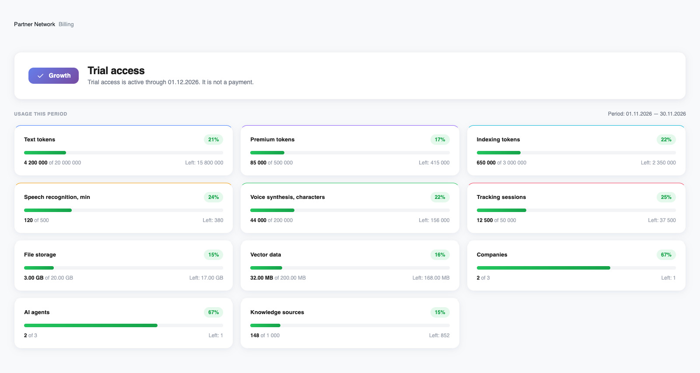
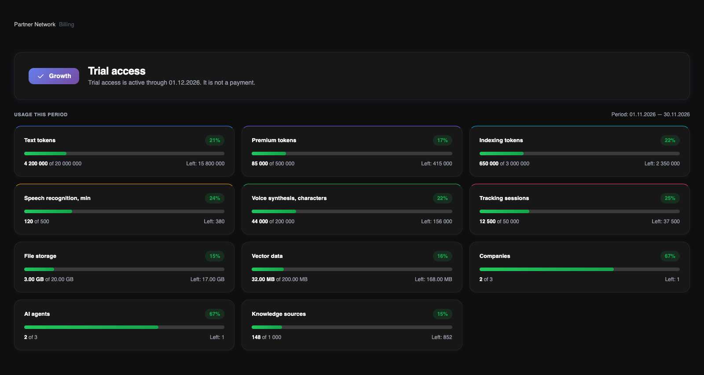

Відкрийте **Білінг**, щоб переглянути план власника акаунта, статус доступу й використані ресурси. **Тарифний план** відкриває каталог, але не активує підписку.

<Frame>
  
  
</Frame>

Інтерфейс англійською у світлій і темній темах. Значення використання — демонстраційні, без даних клієнтів.

## План і статус доступу

Верхня картка показує призначений план і стан пілотного, тестового або підтвердженого платного доступу. Вказано дату завершення доступу; для платного доступу також показано номер оплаченого періоду. Ця дата — межа доступу, а не заплановане списання з картки.

План охоплює компанії власника, але роль кожного учасника окремо визначає доступні дані й дії. Місця рахуються за унікальною email-адресою в межах акаунта, включно з власником і запрошеннями.

## Як читати картки ресурсів

Показуються лише ресурси, включені в призначений план. Кожна картка містить використану кількість, ліміт, залишок і відсоток. Використання AI враховує також ресурси, вже зарезервовані для роботи, що триває.

Текстові та преміум токени охоплюють вхід і вихід моделі. Токени індексації створюють embeddings для пошуку в базі знань, а не навчають саму мовну модель. Голос вимірюється хвилинами розпізнавання та символами синтезу. Файлове й векторне сховища мають окремі ліміти.

## Періоди й обмеження

Для платного доступу облік відповідає підтвердженому оплаченому періоду. Для пілоту й тестового доступу це місячні вікна від дати призначення доступу. Орієнтуйтеся на дати в Білінгу: період не обов’язково починається першого числа місяця.

Індикатори зелені до 80%, помаранчеві від 80% та червоні від 90%. Це візуальні пороги, а не додаткова плата. Досягнення квоти блокує нові дії, яким потрібен цей ресурс. Ліміти місткості не обнуляються з початком нового місяця.

<Note>
Розділ «Події використання» поки є заглушкою попереднього перегляду. Журнал із пошуком, фільтрами й експортом на цій сторінці ще недоступний.
</Note>

Щоб збільшити місткість або змінити план, зверніться до команди Revol. Автоматичних списань за перевищення та миттєвого самостійного підвищення тарифу немає.

[Порівняти плани та включені квоти](/uk/billing/plans)
